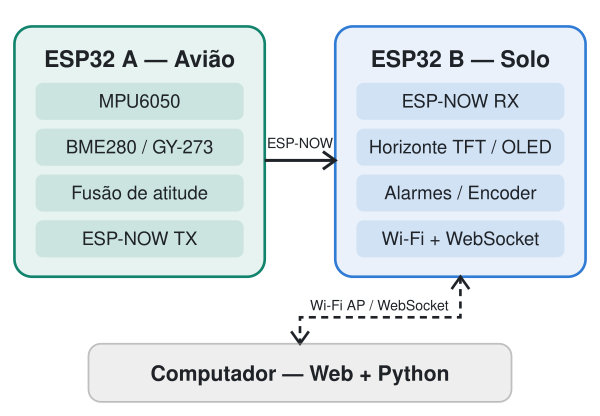
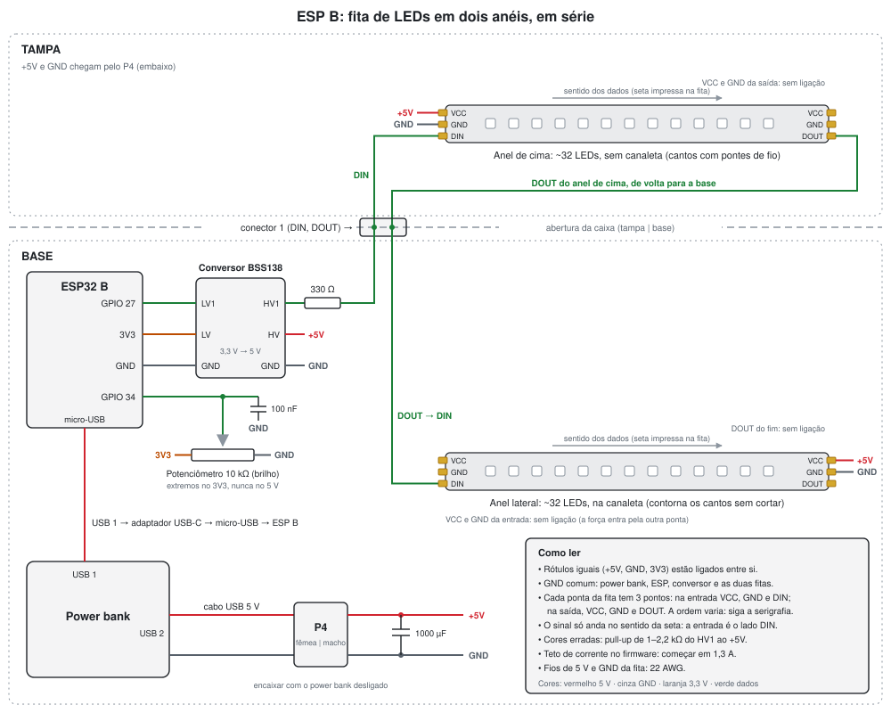

# attitude-indicator — Horizonte Artificial com ESP32

[](https://github.com/rigelsss/attitude-indicator/actions/workflows/ci.yml)

Horizonte artificial em bancada com dois ESP32. Uma placa fica no modelo, mede a atitude (roll, pitch e proa) e a altitude relativa e transmite os dados sem fio. A outra mostra a atitude como um instrumento de painel e a disponibiliza para o navegador e para um cliente Python.

Projeto final da disciplina **Sistemas Embarcados 2026.2**. Usa Arduino via PlatformIO e cobre I2C, SPI, interrupções, FreeRTOS, ESP-NOW e IoT.

> **Estado (07/11/2026):** firmware e software completos e validados em bancada.
> - **ESP A:** pronto, na caixa final da demonstração, com as calibrações gravadas.
> - **ESP B:** horizonte no TFT, dois OLEDs, encoder, alarmes, página web, WebSocket e comandos para o A com confirmação.
> - **PC:** cliente Python com log em CSV, gráficos, comandos e scripts de análise.
> - **Em andamento:** montagem do ESP B na caixa (power bank, buzzer com transistor e anel de LEDs WS2812). Depois vem a apresentação.
>
> Ver [Estado do projeto](#estado-do-projeto).

## Como funciona

<p align="center">
  
</p>

```
ESP A (avião) ──ESP-NOW (50 Hz)──▶ ESP B (solo) ──Wi-Fi AP / WebSocket (30 Hz)──▶ Navegador + Python
              ◀──comandos e ACK──             ◀──comandos (PIN)──
```

- **ESP A, o avião:**
  - lê o MPU6050, o magnetômetro e o barômetro pelo I2C, em tasks FreeRTOS acionadas pela interrupção do MPU (200 Hz);
  - aplica as calibrações e calcula roll e pitch com um filtro complementar, a proa compensada pela inclinação e a altitude relativa;
  - envia um `TelemetryPacket` via ESP-NOW a 50 Hz e executa os comandos recebidos do B (calibrações, zeros, taxa), confirmando cada um;
  - mostra o status num OLED pequeno.
- **ESP B, a estação de solo:**
  - recebe os pacotes, conta perdas e atrasos e desenha o horizonte no TFT;
  - mostra os dados e a saúde do link em dois OLEDs;
  - usa o encoder para escolher e executar o zero e para reconhecer o alarme;
  - dispara alarmes por atitude anormal, inclinação ou perda de link;
  - cria o AP Wi-Fi `Horizonte-ESP`, com uma página web e telemetria em JSON por WebSocket.
- **PC:**
  - a página do horizonte no navegador, que fala "bank angle" no aviso de inclinação;
  - um cliente Python com log em CSV, gráficos ao vivo, comandos e análise das gravações.

## Hardware

| Placa | Componente | Função |
|---|---|---|
| A | ESP32 NodeMCU-32S | Controlador do avião |
| A | MPU6050 (GY-521) | Acelerômetro e giroscópio |
| A | GY-273 (HMC5883L) | Magnetômetro (proa) |
| A | BMP280 (ou BME280) | Pressão e temperatura (altitude relativa). O BME280 da bancada foi danificado em 14/10/2026; o firmware identifica os dois |
| A | OLED 0,91" SSD1306 128x32 | Status |
| B | ESP32 NodeMCU-32S | Estação de solo |
| B | TFT ST7789 | Horizonte artificial |
| B | 2 × OLED 0,96" 128x64 | Dados (OLED 1) e link com a saúde do A (OLED 2) |
| B | Encoder KY-040 | Alvo do zero (giro), zero (pressão longa) e reconhecimento do alarme (pressão curta) |
| B | LED vermelho e LED azul da placa | Alarme e estado do link |
| B | Buzzer ativo com transistor NPN (BU406 da sucata) | Alarme sonoro (aguardando o diodo 1N4148) |
| B | Fita WS2812 IP67 (~65 LEDs em dois anéis), conversor de nível BSS138 e potenciômetro de 10 kΩ | Anel de LEDs da caixa: horizonte em "nível de bolha" e flash do alarme, com brilho ajustável (firmware pronto; fita a caminho) |
| B | Power bank 10 000 mAh | Alimentação do ESP B e da fita |

### Pinagem do ESP A

Os sensores compartilham o barramento I2C principal, alimentados em 3V3. O OLED de status vai num segundo barramento (`Wire1`), para a atualização da tela não atrasar o MPU.

| Sinal | GPIO | Ligação |
|---|---|---|
| I2C SDA | 21 | SDA de todos os módulos |
| I2C SCL | 22 | SCL de todos os módulos |
| I2C1 SDA / SCL (OLED de status) | 32 / 33 | SDA e SCL do OLED 0,91" |
| INT do MPU6050 | 19 | Pino INT da GY-521 ("data ready"). Passe este fio separado do SDA e do SCL: as bordas do pulso induzem ruído no I2C |
| LED de status | 2 | LED da própria placa |

Na GY-521, deixe **AD0 desconectado** (a placa já o mantém em nível baixo, o que seleciona o endereço `0x68`) e **XDA e XCL desconectados**. Endereços esperados: MPU6050 `0x68`, HMC5883L `0x1E`, BMP280/BME280 `0x76` e, no segundo barramento, OLED `0x3C`.

### Pinagem do ESP B

| Sinal | GPIO |
|---|---|
| TFT: MOSI, SCLK, CS, DC, RST | 23, 18, 5, 16, 17 (o BLK do módulo vai no 3V3: luz de fundo sempre acesa) |
| OLED 1 (dados): SDA, SCL | 21, 22 (`Wire`, endereço `0x3C`) |
| OLED 2 (link): SDA, SCL | 4, 19 (`Wire1`, também `0x3C`: um barramento para cada) |
| Encoder: CLK, DT, SW | 32, 33, 25 (alimentar o módulo em 3V3, nunca em 5 V) |
| Buzzer | 26, por um transistor NPN (resistor na base, 1N4148 em paralelo com o buzzer; [caixa-b.md](docs/caixa-b.md)) |
| LED do link | 2 (o LED azul da própria placa) |
| LED de alarme (vermelho) | 13, com resistor de 330 Ω |
| Fita de LEDs (DIN) | 27, pelo conversor BSS138 e um resistor de 330 Ω |
| Potenciômetro do brilho (cursor) | 34 (ADC1; extremos no 3V3 e no GND, 100 nF ao GND) |

A montagem do ESP B foi testada peça por peça com o ambiente `ground_diag` ([solo.md](docs/solo.md), passo 0; resultados no [hardware.md](docs/hardware.md)). A fonte da verdade são os arquivos `include/config.h` de cada firmware e, para o TFT, o `platformio.ini` do ground.

Ligação da fita de LEDs na caixa do B: dois anéis em série, alimentados pelo power bank através de um jack P4 ([caixa-b.md](docs/caixa-b.md)).

<p align="center">
  
</p>

## Estrutura do repositório

| Pasta | Conteúdo |
|---|---|
| `firmware/shared` | Contrato de dados binário (`telemetry.h`) e scripts de build comuns (conferência do MAC antes de gravar, carimbo de compilação) |
| `firmware/aircraft` | Firmware do ESP A, as variantes de teste e o diagnóstico I2C (`src/diag/`, ambiente `i2cscan`) |
| `firmware/ground` | Firmware do ESP B e o diagnóstico do hardware (`ground_diag`) |
| `ground-station/web` | Página do horizonte e dos comandos, servida pelo ESP B ([web.md](docs/web.md)) |
| `ground-station/python` | Cliente WebSocket (CSV, gráficos, comandos), simulador do B e scripts de análise ([cliente-python.md](docs/cliente-python.md)) |
| `docs` | Plano, registros de bancada, estratégias, protocolo WebSocket e figuras |

## Ambiente de desenvolvimento

1. Instale o VS Code e a extensão **PlatformIO IDE**.
2. No VS Code, use **File > Open Workspace from File...** e abra [attitude-indicator.code-workspace](attitude-indicator.code-workspace). O workspace mostra `aircraft (ESP A)`, `ground (ESP B)` e `repositório`.
3. Use o terminal do PlatformIO, em que o comando `pio` já está disponível. Num PowerShell comum, se `pio` não for reconhecido, acrescente-o ao PATH da sessão:

   ```powershell
   $env:Path += ";$env:USERPROFILE\.platformio\penv\Scripts"
   ```

O IntelliSense pressupõe Windows e o PlatformIO instalado em `%USERPROFILE%/.platformio`.

## Compilar e gravar

Cada firmware é um projeto PlatformIO independente. Os comandos partem da raiz do repositório:

```powershell
# ESP A
cd firmware/aircraft
pio run -e aircraft -t upload
pio device monitor -b 115200
```

```powershell
# ESP B (em outro terminal)
cd firmware/ground
pio run -e ground -t upload
pio run -e ground -t uploadfs      # página web no LittleFS
pio device monitor -b 115200
```

As duas placas usam a mesma porta (COM7, uma de cada vez). Antes de `upload` e `uploadfs`, o `check_board_mac.py` confere o MAC da placa e cancela se ela não for a do ambiente. Feche o monitor antes de gravar: ele prende a porta, e o `upload` falha. A primeira linha do boot mostra `compilado em AAAA-MM-DD HH:MM:SS`, o que confirma que a placa está com o firmware que acabou de ser gravado. No `ground`, o monitor grava o log em `firmware/ground/logs`.

### Console do ESP A

O ESP A carrega da NVS as calibrações e mede o bias do giroscópio nos primeiros segundos. A placa precisa estar parada; enquanto ela se mexe, o firmware usa o último bias salvo e tenta de novo. Pelo monitor (use `pio device monitor -b 115200 --echo` para ver o que digita):

| Tecla | Ação |
|---|---|
| `c` | Estado da calibração e valores brutos e corrigidos do último segundo |
| `6` | Calibração do acelerômetro em seis posições, guiada pelo firmware e gravada na NVS depois de confirmar com `s` |
| `g` | Recalibra o bias do giroscópio (placa parada) |
| `z` | Calibração de montagem: corrige o desalinhamento do módulo em relação à caixa, em duas posições ([fusao.md](docs/fusao.md)) |
| `a` | Liga ou desliga o fluxo de atitude (roll e pitch) |
| `r` | Liga ou desliga o resumo por segundo do driver (taxa, ruído, pulsos perdidos e descartados, fila cheia e falhas de I2C) |
| `b` | Liga ou desliga o fluxo de altitude (10 Hz): temperatura, pressão, altitude relativa e variação de temperatura desde o zero |
| `0` | Zera a altitude de novo (média de 2 s com a placa parada) |
| `m` | Calibração do magnetômetro: girar a caixa em todas as orientações até cobrir os 24 setores; revisão com `s` (gravar na NVS), `x` (descartar) e `d` (pontos em CSV para `tools/mag_fit.py`) |
| `p` | Liga ou desliga o fluxo de proa (~10 Hz): proa filtrada, proa do magnetômetro, proa sem compensação, \|m\|, inclinação magnética, roll, pitch e estado |

No ESP A, o LED azul da placa mostra o rádio: apagado = inativo; piscada curta a cada 2 s = enviando sem o B confirmar; 1 Hz = enviando com o B confirmando ([tasks.md](docs/tasks.md), passo 6).

### ESP B

O ESP B recebe a telemetria por ESP-NOW, cria o AP `Horizonte-ESP` com a página e o WebSocket, envia os comandos ao A e mostra o link na serial ([radio.md](docs/radio.md), "ESP B"):

| Tecla (ESP B) | Função |
|---|---|
| `c` | Estado: MACs, canal, link, alarme, OLEDs, encoder, rede (aparelhos, WebSockets, HTTP) e memória |
| `r` | Liga ou desliga o resumo por segundo (começa ligado): recebidos, perdidos, duplicados, fora de ordem, intervalos, idade, atraso estimado e totais |
| `a` | Liga ou desliga o fluxo de pacotes (10 Hz): `seq`, roll, pitch, proa, altitude, `status`, `valid` e `loop_us` |
| `k` | Reconhece o alarme ativo: o LED de alarme para de piscar e fica aceso enquanto a condição durar. A pressão curta do encoder faz o mesmo |
| `g`, `m`, `z`, `0`, `f` | Comandos para o A: calibrar o giroscópio, calibrar o magnetômetro, zerar a atitude, zerar a altitude e trocar a taxa ([web.md](docs/web.md), passo 2) |

- **TFT** ([solo.md](docs/solo.md), passo 5): o horizonte artificial, com escala de pitch, escala de roll e proa. Mostra uma bandeira de falha (X vermelho) quando o dado não é atual ou a atitude é inválida, e `BANK ANGLE` / `ATTITUDE` nos alarmes.
- **OLEDs** ([solo.md](docs/solo.md), passo 3; [caixa-b.md](docs/caixa-b.md)): o OLED 1, à esquerda do TFT, mostra os dados; o OLED 2, à direita, o link e a saúde do A. Todo dado inválido ou sem link aparece como `---`.
- **Encoder:** o giro escolhe o alvo do zero, marcado com `<` no OLED 1 (atitude ou altitude). A pressão longa (1 s) zera o alvo marcado, com o andamento no rodapé.
- **Alarmes** ([solo.md](docs/solo.md), passo 1): o LED vermelho (GPIO 13) avisa link perdido, dado atrasado, atitude inválida, atitude anormal e bank > 35°, cada um com um ritmo. O LED azul da placa fica aceso com o link OK.
  - A atitude anormal segue a definição de "upset" da FAA (bank > 45° ou pitch > +25°), com o nariz para baixo em −20° em vez dos −10° da FAA (escolha do projeto).
  - O aviso de bank > 35° segue o "BANK ANGLE" do EGPWS.

### Página web

Depois do `uploadfs`, conecte-se à rede `Horizonte-ESP` (senha `horizonte123`) e abra `http://192.168.4.1`. O AP aceita até 4 aparelhos ([web.md](docs/web.md)).
- Todos veem o horizonte e os dados; os comandos pedem o PIN (`WEB_CMD_PIN` no `config.h` do B).
- O botão **Som** faz a página falar "bank angle" enquanto o aviso de bank estiver ativo.
- O arquivo de áudio (`ground-station/web/bank-angle.mp3`) é uma gravação de terceiros e fica fora do repositório. Sem ele, a página usa a voz sintética do aparelho ([web.md](docs/web.md), "Som do BANK ANGLE").

### Cliente Python

A partir de `ground-station/python` ([cliente-python.md](docs/cliente-python.md)):

```powershell
python -m pip install -r requirements.txt
python cliente.py                                   # com o PC na rede Horizonte-ESP
python sim_b.py                                     # ou: simulador do B no próprio PC...
python cliente.py --url ws://127.0.0.1:8765/        # ...e o cliente ligado a ele
python graficos.py                                  # gráficos ao vivo do CSV mais recente de logs/
python analisar.py logs\<nome>-tel.csv              # figuras e resumo de uma gravação
```

O cliente grava a telemetria e os eventos em CSV, reconecta sozinho e aceita comandos pelo terminal (`?` lista os comandos). Os scripts `analisar_a.py` e `analisar_b.py` fazem as figuras de jitter, perdas e memória a partir dos logs do monitor serial.

## Testes

A lógica pura (calibração, fusão, barômetro, magnetômetro, contrato, alarmes, link, JSON, servidor HTTP…) roda no PC, sem placa:

```powershell
Push-Location firmware/aircraft; pio test -e native; Pop-Location
Push-Location firmware/ground; pio test -e native; Pop-Location
Push-Location ground-station/python; python -m pytest; Pop-Location
```

O ambiente `native` usa o compilador do PC: é preciso ter um GCC no PATH. No Windows, por exemplo, o do MSYS2 UCRT64 (`C:\msys64\ucrt64\bin`).

O GitHub Actions ([ci.yml](.github/workflows/ci.yml)) roda esses testes e compila os ambientes `aircraft`, `aircraft_pulsetest`, `aircraft_resettest`, `i2cscan`, `ground`, `ground_diag` e `ground_ws20` a cada push e pull request.

## Diagnóstico I2C do ESP A

O ambiente `i2cscan` é um firmware separado que testa o barramento e o MPU6050 acessando os registradores diretamente, sem bibliotecas de sensores. Ele substitui o programa da placa A até que o ambiente `aircraft` seja gravado de novo.

```powershell
cd firmware/aircraft
pio run -e i2cscan -t upload
pio device monitor -b 115200 --echo
```

O diagnóstico faz um scan a 100 kHz e depois aceita comandos de uma letra, sem precisar de Enter:

| Tecla | Ação |
|---|---|
| `s` | Novo scan I2C, com identificação dos chips pelo registrador de ID |
| `l` | Liga ou pausa o fluxo de leituras brutas do MPU |
| `m` | Média e desvio padrão de 400 leituras (2 s), com a placa parada |
| `f` | Alterna o I2C entre 100 e 400 kHz |
| `t` | Teste de contato: lê sem pausa por 5 s e conta as falhas (mexa nos fios durante o teste) |
| `i` | Conta os pulsos do pino INT por 2 s (esperado: 200 Hz) |
| `b` | Liga ou pausa o fluxo do BME280 ou do BMP280: temperatura (°C), pressão (hPa), umidade (%; `--` no BMP280) e variação de altura desde a primeira leitura |
| `h` | Medida do HMC5883L: contagem regressiva de 10 s, 10 leituras (campo em X, Y e Z em µT, módulo e ângulo no plano XY, sem calibração) e a média delas; outro `h` cancela |
| `x` | Autoteste do HMC5883L com o campo interno do chip: polarização positiva e negativa de cada eixo entre 243 e 575 LSB em módulo (faixa do datasheet), OK ou FORA DA FAIXA |

Os valores do MPU são brutos, sem calibração; os do BME280 já vêm compensados com os coeficientes de fábrica do chip, e os do HMC5883L vêm em µT, mas sem calibração. O procedimento de cada teste, os resultados e a orientação dos eixos estão em [docs/hardware.md](docs/hardware.md).

O ESP B tem um diagnóstico equivalente para o hardware dele (LEDs, os dois barramentos I2C, OLEDs, encoder, TFT, sprite e, com as teclas `w` e `p`, a fita de LEDs e o potenciômetro): `pio run -e ground_diag -t upload`, em `firmware/ground`; depois, regrave o `ground`.

## Estado do projeto

Etapas conforme o [plano de desenvolvimento](docs/plano.md):

- [x] Estrutura do repositório, contrato de dados e builds dos dois firmwares
- [x] Diagnóstico I2C
- [x] MPU6050 validado em bancada: endereço, ruído e repouso, seis posições, orientação dos eixos, contato a 100 e 400 kHz e pino INT
- [x] Driver do MPU6050 no firmware do ESP A: ±4 g, ±500 °/s, DLPF, 200 Hz pelo INT e recuperação de falhas
- [x] Calibração no firmware: correção do acelerômetro com persistência na NVS e bias do giroscópio no boot ([estratégia](docs/calibracao.md)), com testes `native`
- [x] Filtro complementar (roll e pitch) e calibração de montagem, com testes `native` ([fusao.md](docs/fusao.md))
- [x] Magnetômetro: calibração hard/soft iron por elipsoide completo, proa compensada pela inclinação e filtro da proa com o giroscópio ([magnetometro.md](docs/magnetometro.md))
- [x] Barômetro: driver próprio, altitude relativa e zero, com testes `native` ([barometro.md](docs/barometro.md))
- [x] OLED de status no ESP A e tasks FreeRTOS acionadas pelo INT ([tasks.md](docs/tasks.md))
- [x] ESP-NOW A → B com detecção de perda de pacotes e de atraso ([radio.md](docs/radio.md))
- [x] ESP B: horizonte no TFT, dois OLEDs, encoder e alarmes ([solo.md](docs/solo.md))
- [x] ESP B: AP Wi-Fi, página web e WebSocket; comandos com confirmação (ACK) ([web.md](docs/web.md))
- [x] Cliente Python e métricas: jitter do loop, perda e latência ([cliente-python.md](docs/cliente-python.md))
- [x] Caixa do ESP A, que é o modelo final da demonstração
- [ ] Caixa do ESP B: power bank, buzzer com transistor e anel de LEDs ([caixa-b.md](docs/caixa-b.md))
- [ ] Slides e ensaio da apresentação

Os testes de detalhe que não mudam a demonstração ficam para depois: o projeto pode virar TCC ([plano.md](docs/plano.md), "Adiado para o TCC").

## Documentação

| Documento | Conteúdo |
|---|---|
| [docs/plano.md](docs/plano.md) | Etapas semanais, situação atual, pendências e riscos |
| [docs/hardware.md](docs/hardware.md) | Registro de bancada: endereços, medidas, calibração e orientação |
| [docs/calibracao.md](docs/calibracao.md) | Estratégia de calibração do MPU6050 |
| [docs/fusao.md](docs/fusao.md) | Filtro complementar (roll e pitch), calibração de montagem e validação |
| [docs/barometro.md](docs/barometro.md) | Barômetro: configuração, altitude relativa, zero e roteiro de validação |
| [docs/magnetometro.md](docs/magnetometro.md) | HMC5883L: mapeamento de eixos, calibração hard/soft iron, proa compensada, filtro da proa e roteiro de validação |
| [docs/refatoracao.md](docs/refatoracao.md) | Refatoração do `main.cpp` provisório em módulos |
| [docs/tasks.md](docs/tasks.md) | Tasks FreeRTOS do ESP A: núcleos, prioridades, filas e medições de tempo |
| [docs/radio.md](docs/radio.md) | ESP-NOW: configuração do A e do B, campos do pacote e bancada do rádio |
| [docs/solo.md](docs/solo.md) | ESP B: TFT, OLEDs, encoder, alarmes e diagnóstico |
| [docs/web.md](docs/web.md) | Comandos do B para o A, servidor web, WebSocket, página e som do BANK ANGLE |
| [docs/cliente-python.md](docs/cliente-python.md) | Cliente Python, métricas e bancadas de rede |
| [docs/caixa-b.md](docs/caixa-b.md) | Montagem do ESP B na caixa: power bank, conectores, buzzer e anel de LEDs |
| [docs/protocolo-websocket.md](docs/protocolo-websocket.md) | Contrato JSON entre o ESP B e os clientes |
| [firmware/shared/include/telemetry.h](firmware/shared/include/telemetry.h) | Contrato binário ESP-NOW entre o ESP A e o ESP B |

## Autoria

**Rigel Sales**, Sistemas Embarcados 2026.2.
