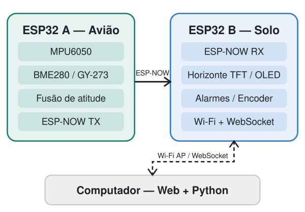

# attitude-indicator — Horizonte Artificial com ESP32

[](https://github.com/rigelsss/attitude-indicator/actions/workflows/ci.yml)

Horizonte artificial em bancada com dois ESP32. Uma placa fica no modelo, mede a atitude (roll, pitch e proa) com sensores inerciais e a transmite sem fio. A outra mostra essa atitude como um instrumento de painel e a disponibiliza para o navegador e para um cliente Python.

Projeto final da disciplina **Sistemas Embarcados 2026.2**. Usa Arduino via PlatformIO e cobre I2C, SPI, interrupções, FreeRTOS, ESP-NOW e IoT.

> **Estado:** em desenvolvimento.
> - **ESP A:** tasks FreeRTOS acionadas pelo INT do MPU. Lê e calibra o MPU6050, o magnetômetro e o barômetro (BMP280), calcula roll, pitch e a proa compensada pela inclinação e envia a telemetria por ESP-NOW a 50 Hz, com um OLED de status. Tudo validado em bancada.
> - **ESP B:** recebe a telemetria, conta perdas e quedas do link e cria o AP Wi-Fi no mesmo canal.
> - **Falta:** horizonte no TFT, encoder e alarmes no B, página web, WebSocket, comandos e cliente Python.
>
> Ver [Estado do projeto](#estado-do-projeto).

## Como funciona

<p align="center">
  
</p>

```
ESP A (avião) ──ESP-NOW──▶ ESP B (solo) ──Wi-Fi AP / WebSocket──▶ Navegador + Python
```

- **ESP A, o avião:** lê o MPU6050, o magnetômetro e o barômetro pelo I2C, aplica a calibração, calcula a atitude com um filtro complementar e envia um `TelemetryPacket` via ESP-NOW a 50 Hz. Um OLED pequeno mostra o status.
- **ESP B, a estação de solo:** recebe os pacotes, desenha o horizonte no TFT, mostra os dados num OLED, troca de tela pelo encoder e dispara alarmes (buzzer e LEDs) por inclinação excessiva ou perda de link. Também cria o AP Wi-Fi `Horizonte-ESP`, com uma página web e telemetria em JSON por WebSocket.
- **PC:** a página do horizonte no navegador e um cliente Python para log em CSV, gráficos e envio de comandos.

## Hardware

| Placa | Componente | Função |
|---|---|---|
| A | ESP32 NodeMCU-32S | Controlador do avião |
| A | MPU6050 (GY-521) | Acelerômetro e giroscópio |
| A | GY-273 (HMC5883L) | Magnetômetro (proa) |
| A | BME280 ou BMP280 | Pressão e temperatura (altitude relativa). O BME280 da bancada foi danificado em 14/10/2026; o firmware identifica os dois |
| A | OLED 0,91" SSD1306 128x32 | Status |
| B | ESP32 NodeMCU-32S | Estação de solo |
| B | TFT ST7789 | Horizonte artificial |
| B | OLED 0,96" 128x64 | Dados numéricos |
| B | Encoder KY-040 | Troca de página do OLED e reconhecimento do alarme |
| B | LED vermelho, LED azul da placa e buzzer ativo (adiado) | Alarme e estado do link |

### Pinagem do ESP A

Os sensores compartilham o barramento I2C principal, alimentados em 3V3. O OLED de status vai num segundo barramento (`Wire1`), para a atualização da tela não atrasar o MPU.

| Sinal | GPIO | Ligação |
|---|---|---|
| I2C SDA | 21 | SDA de todos os módulos |
| I2C SCL | 22 | SCL de todos os módulos |
| I2C1 SDA / SCL (OLED de status) | 32 / 33 | SDA e SCL do OLED 0,91" |
| INT do MPU6050 | 19 | Pino INT da GY-521 ("data ready"). Passe este fio separado do SDA e do SCL: as bordas do pulso induzem ruído no I2C |
| LED de status | 2 | LED da própria placa |

Na GY-521, deixe **AD0 desconectado** (a placa já o mantém em nível baixo, o que seleciona o endereço `0x68`) e **XDA e XCL desconectados**. Endereços esperados: MPU6050 `0x68`, HMC5883L `0x1E`, BME280/BMP280 `0x76` e, no segundo barramento, OLED `0x3C`.

### Pinagem do ESP B

| Sinal | GPIO |
|---|---|
| TFT: MOSI, SCLK, CS, DC, RST | 23, 18, 5, 16, 17 (o BLK do módulo vai no 3V3: luz de fundo sempre acesa) |
| OLED: SDA, SCL | 21, 22 (endereço `0x3C`) |
| Encoder: CLK, DT, SW | 32, 33, 25 (alimentar o módulo em 3V3, nunca em 5 V) |
| Buzzer | 26, **adiado**: sem transistor; ligar direto só se a corrente medida em 3,3 V der até ~12 mA |
| LED do link | 2 (o LED azul da própria placa) |
| LED de alarme (vermelho) | 13, com resistor de 330 Ω |

A montagem do ESP B foi testada peça por peça em 23/10/2026 com o ambiente `ground_diag` ([solo.md](docs/solo.md), passo 0; resultados no [hardware.md](docs/hardware.md)). A fonte da verdade são os arquivos `include/config.h` de cada firmware e, para o TFT, o `platformio.ini` do ground.

<!-- Foto da montagem ou diagrama de ligação: acrescentar quando a montagem estiver concluída. -->

## Estrutura do repositório

| Pasta | Conteúdo |
|---|---|
| `firmware/shared` | Contrato de dados binário (`telemetry.h`), usado pelos dois firmwares |
| `firmware/aircraft` | Firmware do ESP A e o diagnóstico I2C (`src/diag/`, ambiente `i2cscan`) |
| `firmware/ground` | Firmware do ESP B |
| `ground-station/web` | Página do horizonte, servida pelo ESP B (a fazer) |
| `ground-station/python` | Cliente de log, gráficos e comandos (a fazer) |
| `docs` | Plano, registros de bancada, estratégia de calibração e protocolo WebSocket |

## Ambiente de desenvolvimento

1. Instale o VS Code e a extensão **PlatformIO IDE**.
2. No VS Code, use **File > Open Workspace from File...** e abra [attitude-indicator.code-workspace](attitude-indicator.code-workspace). O workspace mostra `aircraft (ESP A)`, `ground (ESP B)` e `repositório`.
3. Use o terminal do PlatformIO, em que o comando `pio` já está disponível. Num PowerShell comum, se `pio` não for reconhecido, acrescente-o ao PATH da sessão:

   ```powershell
   $env:Path += ";$env:USERPROFILE\.platformio\penv\Scripts"
   ```

O IntelliSense pressupõe Windows e o PlatformIO instalado em `%USERPROFILE%/.platformio`.

## Compilar e gravar

Cada firmware é um projeto PlatformIO independente. Os comandos partem da raiz do repositório:

```powershell
# ESP A
cd firmware/aircraft
pio run -e aircraft -t upload
pio device monitor -b 115200
```

```powershell
# ESP B (em outro terminal)
cd firmware/ground
pio run -e ground -t upload
pio device monitor -b 115200
```

No estado atual, o ESP A configura o MPU6050, o magnetômetro e o barômetro, carrega da NVS as calibrações e mede o bias do giroscópio nos primeiros segundos. A placa precisa estar parada; enquanto ela se mexe, o firmware usa o último bias salvo e tenta de novo. Pelo monitor (use `pio device monitor -b 115200 --echo` para ver o que digita):

| Tecla | Ação |
|---|---|
| `c` | Estado da calibração e valores brutos e corrigidos do último segundo |
| `6` | Calibração do acelerômetro em seis posições, guiada pelo firmware e gravada na NVS depois de confirmar com `s` |
| `g` | Recalibra o bias do giroscópio (placa parada) |
| `z` | Calibração de montagem: corrige o desalinhamento do módulo em relação à caixa, em duas posições ([fusao.md](docs/fusao.md)) |
| `a` | Liga ou desliga o fluxo de atitude (roll e pitch) |
| `r` | Liga ou desliga o resumo por segundo do driver (taxa, ruído, pulsos perdidos e descartados, fila cheia e falhas de I2C) |
| `b` | Liga ou desliga o fluxo de altitude (10 Hz): temperatura, pressão, altitude relativa e variação de temperatura desde o zero |
| `0` | Zera a altitude de novo (média de 2 s com a placa parada) |
| `m` | Calibração do magnetômetro: girar a caixa em todas as orientações até cobrir os 24 setores; revisão com `s` (gravar na NVS), `x` (descartar) e `d` (pontos em CSV para `tools/mag_fit.py`) |
| `p` | Liga ou desliga o fluxo de proa (~10 Hz): proa filtrada, proa do magnetômetro, proa sem compensação, \|m\|, inclinação magnética, roll, pitch e estado |

No ESP A, o LED azul da placa mostra o rádio: apagado = inativo; piscada curta a cada 2 s = enviando sem o B confirmar; 1 Hz = enviando com o B confirmando ([tasks.md](docs/tasks.md), passo 6).

O ESP B recebe a telemetria por ESP-NOW, cria o AP `Horizonte-ESP` (ainda sem página) e mostra o link na serial ([radio.md](docs/radio.md), "ESP B"):

| Tecla (ESP B) | Função |
|---|---|
| `c` | Estado: MACs, canal, peer, totais do link desde o boot e pacotes recusados por motivo |
| `r` | Liga ou desliga o resumo por segundo (começa ligado): recebidos, perdidos, duplicados, intervalo entre chegadas no B e pelo relógio do A, idade e totais |
| `a` | Liga ou desliga o fluxo de pacotes (10 Hz): `seq`, roll, pitch, proa, altitude, `status`, `valid` e `loop_us` |
| `k` | Reconhece o alarme ativo: o LED de alarme para de piscar e fica aceso enquanto a condição durar. O botão do encoder (pressão curta) faz o mesmo |

Os eventos do link (`estabelecido`, `PERDIDO`, `restabelecido`, `ressincronizado`) e as mudanças de alarme são sempre impressos. O OLED de 0,96" mostra duas páginas, dados e link com a saúde do A, com `---` para todo dado inválido ou sem link ([solo.md](docs/solo.md), passo 3). O giro do encoder troca a página, e a pressão longa (1 s) fica reservada para os comandos ([solo.md](docs/solo.md), passo 2). O LED vermelho (GPIO 13) avisa link perdido, atitude inválida, atitude anormal (bank > 45°, pitch > +25° ou < −10°) e bank > 35°, cada um com um ritmo; o LED azul da placa fica aceso com o link OK ([solo.md](docs/solo.md), passo 1).

Feche o monitor antes de gravar: ele prende a porta, e o `upload` falha. A primeira linha do boot mostra `compilado em AAAA-MM-DD HH:MM:SS`, o que confirma que a placa está com o firmware que acabou de ser gravado.

Para só compilar, omita `-t upload`. Se houver mais de uma placa conectada, defina `upload_port` e `monitor_port` no `platformio.ini` correspondente, ou passe `-p COMx` no monitor.

Testes da lógica pura, que rodam no PC, sem placa: em `firmware/aircraft` (calibração, fusão, barômetro, magnetômetro e pacote) e em `firmware/ground` (conferência do pacote recebido e contagem de perdas):

```powershell
pio test -e native
```

O ambiente `native` usa o compilador do PC: é preciso ter um GCC no PATH. No Windows, por exemplo, o do MSYS2 UCRT64 (`C:\msys64\ucrt64\bin`).

O GitHub Actions ([ci.yml](.github/workflows/ci.yml)) roda esses testes e compila `aircraft`, `i2cscan` e `ground` a cada push e pull request.

Página web no ESP B (quando existir): `pio run -e ground -t uploadfs`, em `firmware/ground`. Depois, conecte-se à rede `Horizonte-ESP` e abra `http://192.168.4.1`.

## Diagnóstico I2C do ESP A

O ambiente `i2cscan` é um firmware separado que testa o barramento e o MPU6050 acessando os registradores diretamente, sem bibliotecas de sensores. Ele substitui o programa da placa A até que o ambiente `aircraft` seja gravado de novo.

```powershell
cd firmware/aircraft
pio run -e i2cscan -t upload
pio device monitor -b 115200 --echo
```

O diagnóstico faz um scan a 100 kHz e depois aceita comandos de uma letra, sem precisar de Enter:

| Tecla | Ação |
|---|---|
| `s` | Novo scan I2C, com identificação dos chips pelo registrador de ID |
| `l` | Liga ou pausa o fluxo de leituras brutas do MPU |
| `m` | Média e desvio padrão de 400 leituras (2 s), com a placa parada |
| `f` | Alterna o I2C entre 100 e 400 kHz |
| `t` | Teste de contato: lê sem pausa por 5 s e conta as falhas (mexa nos fios durante o teste) |
| `i` | Conta os pulsos do pino INT por 2 s (esperado: 200 Hz) |
| `b` | Liga ou pausa o fluxo do BME280 ou do BMP280: temperatura (°C), pressão (hPa), umidade (%; `--` no BMP280) e variação de altura desde a primeira leitura |
| `h` | Medida do HMC5883L: contagem regressiva de 10 s, 10 leituras (campo em X, Y e Z em µT, módulo e ângulo no plano XY, sem calibração) e a média delas; outro `h` cancela |
| `x` | Autoteste do HMC5883L com o campo interno do chip: polarização positiva e negativa de cada eixo entre 243 e 575 LSB em módulo (faixa do datasheet), OK ou FORA DA FAIXA |

Os valores do MPU são brutos, sem calibração; os do BME280 já vêm compensados com os coeficientes de fábrica do chip, e os do HMC5883L vêm em µT, mas sem calibração. O procedimento de cada teste, os resultados e a orientação dos eixos estão em [docs/hardware.md](docs/hardware.md).

## Estado do projeto

Etapas conforme o [plano de desenvolvimento](docs/plano.md):

- [x] Estrutura do repositório, contrato de dados e builds dos dois firmwares
- [x] Diagnóstico I2C
- [x] MPU6050 validado em bancada: endereço, ruído e repouso, seis posições, orientação dos eixos, contato a 100 e 400 kHz e pino INT
- [x] Driver do MPU6050 no firmware do ESP A: ±4 g, ±500 °/s, DLPF, 200 Hz pelo INT e recuperação de falhas
- [x] Calibração no firmware: correção do acelerômetro com persistência na NVS e bias do giroscópio no boot ([estratégia](docs/calibracao.md)), com testes `native`
- [x] Filtro complementar (roll e pitch) e calibração de montagem, com testes `native` ([fusao.md](docs/fusao.md))
- [x] Magnetômetro: calibração hard/soft iron por elipsoide completo, proa compensada pela inclinação e filtro da proa com o giroscópio ([magnetometro.md](docs/magnetometro.md))
- [x] Barômetro: driver próprio, altitude relativa e zero, com testes `native` ([barometro.md](docs/barometro.md))
- [x] Barômetro com o BMP280 na bancada (o BME280 foi danificado) e convivência dos três sensores
- [x] OLED de status no ESP A ([tasks.md](docs/tasks.md), passo 6)
- [x] Tasks FreeRTOS no ESP A acionadas pelo INT ([tasks.md](docs/tasks.md))
- [x] ESP-NOW A → B com detecção de perda de pacotes ([radio.md](docs/radio.md))
- [ ] ESP B: horizonte no TFT, OLED, encoder e alarmes
- [ ] ESP B: AP Wi-Fi, página web e WebSocket; comandos com confirmação (ACK)
- [ ] Cliente Python e métricas (jitter, perda e latência)

## Documentação

| Documento | Conteúdo |
|---|---|
| [docs/plano.md](docs/plano.md) | Etapas semanais e riscos |
| [docs/hardware.md](docs/hardware.md) | Registro de bancada: endereços, medidas, calibração e orientação |
| [docs/calibracao.md](docs/calibracao.md) | Estratégia de calibração do MPU6050 |
| [docs/fusao.md](docs/fusao.md) | Filtro complementar (roll e pitch), calibração de montagem e validação |
| [docs/barometro.md](docs/barometro.md) | BME280: configuração, altitude relativa, zero e roteiro de validação |
| [docs/magnetometro.md](docs/magnetometro.md) | HMC5883L: mapeamento de eixos, calibração hard/soft iron, proa compensada, filtro da proa e roteiro de validação |
| [docs/protocolo-websocket.md](docs/protocolo-websocket.md) | Contrato JSON entre o ESP B e os clientes |
| [firmware/shared/include/telemetry.h](firmware/shared/include/telemetry.h) | Contrato binário ESP-NOW entre o ESP A e o ESP B |

## Autoria

**Rigel Sales**, Sistemas Embarcados 2026.2.
