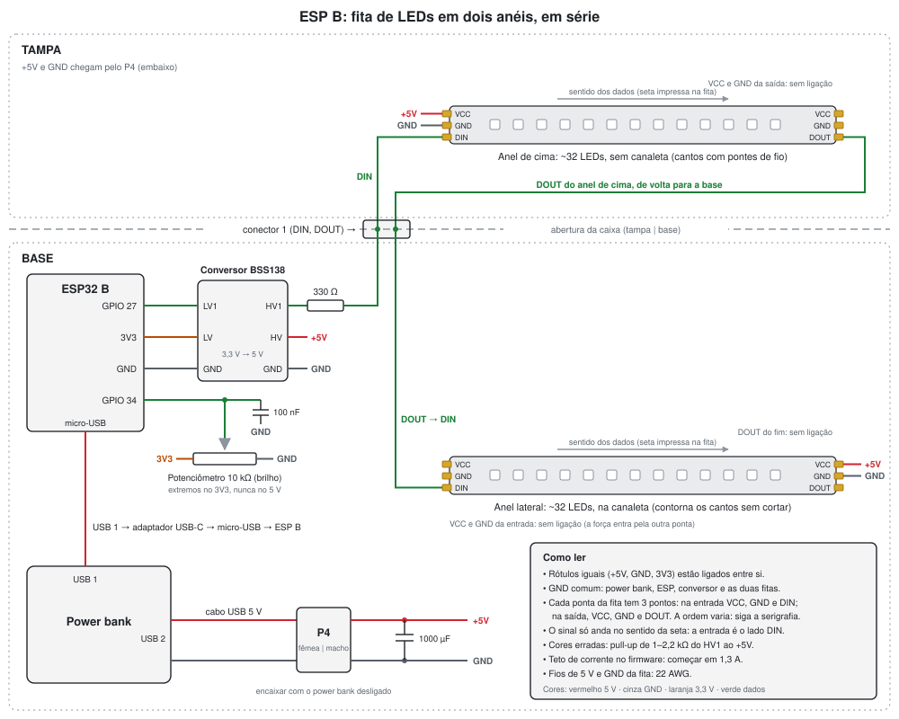

# Caixa do B: alimentação, tampa, segundo OLED, buzzer e anel de LEDs

Discutido em 29/10/2026, **sem código ainda**. Reúne as decisões sobre a montagem do ESP B na caixa e os extras que vieram com ela. Nada aqui foi medido: as correntes e a autonomia são estimativas, a conferir na bancada e registrar no [hardware.md](hardware.md).

**Prioridade (revista em 07/11/2026):** a caixa do B é a prioridade até a entrega, com o anel de LEDs ([plano.md](plano.md), "Situação em 07/11/2026"). O segundo OLED já está no firmware (02/11/2026). A proa no anel continua um extra.

**Situação em 07/11/2026:** a caixa e o power bank estão prontos. Falta o adaptador USB-C → micro-USB (chega de 5 a 9/11) para instalar a protoboard, o power bank, o buzzer, o potenciômetro e o encoder, o 1N4148 do buzzer (de 6 a 12/11) e a fita de LEDs (de 9 a 11/11). Faltam soldar os pinos do conversor de nível. Os dois OLEDs já estão instalados e funcionando (conferido pelo usuário, 07/11/2026).

## Peças (29/10/2026)

| Peça | Situação |
|---|---|
| Power bank Espada BTE-28E (10 000 mAh, 32 Wh; saídas de 5 V e 3,1 A no rótulo) | comprado |
| ~~Fita WS2812B, 1 m, 60 LEDs/m~~ | trocada pela de baixo |
| **Fita WS2812 IP67, 5 m, 300 LEDs (60 LEDs/m), 5 V** | comprada; chega de 9 a 11/11/2026 |
| 2 módulos conversores de nível bidirecionais I2C (BSS138, 3,3 ↔ 5 V) | chegaram; falta soldar os pinos |
| Canaleta para fita de LED, com difusor | disponível, o bastante para os dois anéis |
| Jack P4 macho e fêmea, cabo USB 5 V do power bank para a fita | para a alimentação da fita (abaixo) |
| Adaptador USB-C → micro-USB (power bank → ESP B) | chega de 5 a 9/11/2026 |
| Conectores macho e fêmea de 4 pinos para a tampa (provavelmente JST XH 2,54 mm; conferir) | comprados |
| Transistor NPN para o buzzer e 1N4148 | **sem BC337** (07/11/2026: estava na lista de compras, não foi comprado); candidato da sucata: **BU406** (seção "Buzzer"). 1N4148 chega de 6 a 12/11/2026 |
| Capacitor de 1000 µF (10 ou 16 V), resistores de 330 Ω, 1 kΩ e 2,2 kΩ, capacitores de 100 nF | já disponíveis |
| Potenciômetro linear de 10 kΩ | disponível |
| 74AHCT125 / 74HCT125 / 74HCT541 | **não encontrados em DIP** em tempo hábil; só reserva (ver "Sinal da fita") |

Atenção na compra de CIs: o **74HC** (sem o T) alimentado em 5 V só aceita como "1" uma entrada acima de 3,5 V e não converte os 3,3 V do ESP. O **HCT/AHCT** aceita a partir de 2,0 V.

## Alimentação pelo power bank

- **Consumo estimado do B sem a fita:** 200–350 mA (ESP32 com o AP e o ESP-NOW 120–180 mA, com picos de ~400 mA; TFT ~20–60 mA; cada OLED ~20 mA; LEDs de alarme). **Com os dois anéis:** ~0,6–1,5 A, conforme o brilho (teto no firmware; seção "Brilho e corrente").
- **Autonomia estimada:** ~5 Ah úteis em 5 V (32 Wh, eficiência de 80–85 %). Isso dá ~15–18 h sem a fita e ~3–8 h com ela, conforme o brilho.
- **A fita é alimentada direto pelos 5 V do power bank** (cabo USB separado, pelo jack P4; 07/11/2026), nunca pelo VIN ou pelo 3V3 da placa. O GND é comum com o ESP, e um capacitor de 1000 µF fica entre o 5 V e o GND, na entrada da fita.
- **Bancada a fazer:**
  1. **Desligamento automático por carga baixa:** muitos power banks desligam abaixo de 50–100 mA. Deixar o B ligado no power bank por 30–60 min. Se ele desligar sozinho, o B reinicia, e isso pode ser confundido com o travamento do B ([plano.md](plano.md), semana 6).
  2. **Brownout:** um cabo micro-USB fino derruba a tensão nos picos do Wi-Fi. Procurar `Brownout detector was triggered` no monitor. Usar um cabo curto e bom.
  3. **Com a fita:** aquecimento e autonomia com o anel no teto de corrente.

## Layout da caixa

- **Quem olha de frente é o piloto.** O nariz do avião é a borda da tampa mais distante do observador, a asa direita fica à direita dele e a borda mais próxima é a cauda. O TFT e o anel se comportam como o horizonte visto da cabine.
- **A caixa fica com o lado longo (15,5 cm) de frente para o observador:** a linha de displays é larga.
- **Tampa (12,5 × 15,5 cm):** **OLED 1 | TFT | OLED 2** em linha, no centro, de pé para o observador. Com a fita na borda (~1 cm de largura), sobram ~10,5 × 13,5 cm por dentro.
- **Encoder e potenciômetro na parede da frente** da caixa, do lado do piloto. Os fios correm por dentro da caixa até o ESP e não passam pela tampa. Na tampa, a mão cobriria os LEDs.
- **A tampa abre: conectores de 4 pinos** entre a caixa e a tampa, um por grupo, para soltar a tampa sem dessoldar e testar um display de cada vez:

  | Conector | Pinos |
  |---|---|
  | 1. Fita | DIN, DOUT (o sinal volta do anel de cima para o lateral), 2 vagos. Os 5 V e o GND da fita passam pelo P4 (07/11/2026) |
  | 2. OLED 1 | 3V3, GND, SDA (21), SCL (22) |
  | 3. OLED 2 | 3V3, GND, SDA2 (4), SCL2 (19) |
  | 4. TFT (a) | 3V3, GND, SCLK (18), MOSI (23) |
  | 5. TFT (b) | CS (5), DC (16), RST (17), (vazio) |

  - **Risco:** os conectores são iguais e podem ser trocados ao fechar a tampa. Com os 5 V da fita no P4 (07/11/2026), nenhum conector de 4 pinos leva 5 V, mas uma troca ainda liga o sinal de um display no de outro. Marcar cada par com cor e número.
  - O BLK do TFT continua preso ao 3V3 do lado da tampa ([solo.md](solo.md), passo 0).
  - Fio de 22 AWG no 5V e no GND da fita, do cabo USB ao P4 e do P4 às fitas.
  - **SPI do TFT pelo cabo da tampa (~20–30 cm):** se aparecerem pixels errados ou faixas, baixar a frequência do SPI no `platformio.ini`. Conferir na bancada da montagem.

## Segundo OLED

- **O segundo OLED 0,96" não tem o resistor de seleção de endereço** e fica em `0x3C`, como o primeiro. Por isso vai no **segundo controlador I2C (`Wire1`), SDA no GPIO 4 e SCL no GPIO 19**. Os dois pinos estão livres e não são de strapping crítico. Os pull-ups vêm no módulo.
  - O GPIO 19 é o MISO padrão do SPI. O TFT não usa MISO. **Conferido na compilação (02/11/2026):** sem o `TFT_MISO` definido, a TFT_eSPI chama `spi.begin(18, -1, 23, -1)` e não toca no GPIO 19.
  - Barramentos independentes: cada OLED leva os mesmos 32,7 ms por quadro a 400 kHz ([solo.md](solo.md), passo 3), e um não atrasa o outro.
- **Uma página fixa por OLED**, em vez das duas páginas trocadas pelo giro do encoder: **à esquerda os dados** (a página 1 de antes), **à direita o link e a saúde do A** (a página 2).
- **Implementado em 02/11/2026** (compilado e com testes `native`; bancada a fazer, [hardware.md](hardware.md)). As decisões que estavam em aberto:
  - **pressão longa:** o giro escolhe, a pressão longa executa. O OLED 1 marca com `<`, na última coluna, a linha que será zerada: ROLL/PIT (atitude) ou ALT (altitude). Cada clique, nos dois sentidos, troca o alvo; a pressão de 1 s zera o alvo marcado. No boot, o alvo é a atitude. O rodapé do andamento ("segure 1s: ZERO ATT", "ACEITO", "OK"…) continua no OLED 1. Assim, o giro do encoder continua com função (o tópico "encoder via interrupção" da semana 4). Descartadas: 1 s zera a atitude e 3 s a altitude (fácil de errar, giro sem função), e a pressão longa só para a atitude;
  - **uma `oled_task` dona dos dois barramentos:** redesenha cada OLED a 5 Hz, um depois do outro (~65 ms dos 200 ms), e o OLED 1 na hora em que o alvo muda. Cada OLED tem a sua presença e a sua nova tentativa a cada 5 s: um ausente não afeta o outro. Sem o OLED 2, o B funciona como antes, só com os dados no OLED 1;
  - **o `Wire1` na U8g2:** a classe `U8G2_SSD1306_128X64_NONAME_F_2ND_HW_I2C` só é compilada com `WIRE_INTERFACES_COUNT` definido, e o núcleo do ESP32 não o define: `-D WIRE_INTERFACES_COUNT=2` no `platformio.ini`. Ela inicia o `Wire1` sem pinos, por isso os pinos vão antes, por `setPins`;
  - **`ground_diag`:** o `i` varre os dois barramentos, e o `o` desenha "ESP B - OLED 1" e "ESP B - OLED 2", cada um no seu display;
  - **console:** o `c` mostra uma linha por OLED (`oled 1 (dados, SDA 21 / SCL 22): presente | …`) e o alvo da pressão longa na linha `encoder:`; os eventos são `[enc] clique horário, alvo da pressão longa: zerar altitude` e `[oled] OLED 2 (link): AUSENTE …`.

## Buzzer

- **Fica o buzzer ativo.** Os alarmes se diferenciam pelo ritmo dos bipes, que a `alarm_task` já prevê ([solo.md](solo.md), "Decisões").
- **Transistor (revisto em 07/11/2026):** o BC337 não foi comprado. Serve qualquer NPN pequeno: BC337/338, BC547/548/549, 2N2222/PN2222, 2N3904 ou S8050, com a mesma ligação; a pinagem muda entre eles (C-B-E nos BC, E-B-C no 2N2222 e no 2N3904), então conferir pelo datasheet. **Candidato da sucata: BU406** (NPN de potência TO-220, de deflexão horizontal de TV, 7 A e 200 V):
  - serve como chave para os ~20–30 mA do buzzer, mas tem ganho baixo (da ordem de 10–20): com 1 kΩ, a base recebe ~2,5 mA e o transistor pode não saturar. **Usar 470 Ω na base** (~5 mA do GPIO, dentro dos ~12 mA);
  - pinagem TO-220, de frente para a face com o texto e os pinos para baixo: **B – C – E**, com a aba metálica no coletor (não encostar a aba no GND nem em outro fio). Conferir no datasheet do fabricante;
  - por ser de sucata, testar antes no modo diodo do multímetro: base → emissor e base → coletor com ~0,5–0,7 V, e coletor ↔ emissor aberto nos dois sentidos;
  - na bancada, com o buzzer ligado, a tensão entre coletor e emissor deve ficar abaixo de ~0,5 V; se ficar alta, o transistor não saturou (baixar o resistor da base para 330 Ω, que dá ~7,5 mA).
- **Sem transistor:** só se o buzzer gastar até ~12 mA no 3V3 (medir com o multímetro em série); aí ele vai direto no GPIO 26.
- **Ligação (com qualquer NPN):** GPIO 26 → resistor (1 kΩ; 470 Ω no BU406) → base; emissor no GND; coletor no (−) do buzzer; (+) do buzzer na alimentação dele (5 V ou 3V3, conforme o buzzer); 1N4148 em paralelo com o buzzer, com o cátodo (faixa) no (+).
  - O diodo protege o transistor do pico da bobina de um buzzer magnético. Num piezo, não faz falta, mas não atrapalha.
  - **Pinagem do BC337, se for comprado:** com a face plana virada para você e os pinos para baixo, **C – B – E** (diferente do 2N2222). Conferir no datasheet antes de soldar.

## Anel de LEDs (prioridade desde 07/11/2026)

### Montagem (revista em 07/11/2026: dois anéis)



Esquema: [img/ligacao-fita.svg](img/ligacao-fita.svg). Os rótulos iguais (+5V, GND, 3V3) estão ligados entre si.


- **Dois anéis, ~32 LEDs cada, ~65 no total:**
  - **em cima, na borda da tampa, sem canaleta.** O perímetro é de 56 cm. Cortando nas marcas (1,67 cm por LED): **9 LEDs em cada lado de 15,5 cm e 7 em cada lado de 12,5 cm, 32 no total**. O silicone do IP67 já espalha um pouco a luz;
  - **nas laterais, dentro da canaleta com difusor**, que deixa a luz contínua e suave para quem está em volta. O perímetro é o mesmo, ~32 LEDs.
- **Em série, num pino só** (decidido em 07/11/2026): GPIO 27 → conversor → anel de cima → anel lateral, como uma fita só. Se o anel de cima estiver na tampa, o sinal volta pelo 4º pino do conector 1 (DOUT). A alternativa, um pino por anel (27 e 14), foi descartada: gasta um GPIO e um canal do conversor sem ganho.
- **Cantos do anel de cima cortados e emendados com fio:** 3 fios por canto (5V, dado, GND), 22–24 AWG, pontes curtas e termorretrátil. Ali a dobra seria no plano da fita, o que força as trilhas. **No anel lateral, a fita contorna os cantos sem cortar** (a dobra é no sentido em que ela flexiona); a canaleta, se for rígida, é cortada em 45° nos cantos.
- **Fita IP67** (silicone):
  - **largura de ~12 mm e altura de ~4–5 mm** com o silicone. **A canaleta comporta os 12 mm** (conferido pelo usuário, 07/11/2026);
  - em cada corte, abrir o silicone para soldar e vedar a ponta depois (cola quente ou silicone);
  - o adesivo do verso costuma descolar do silicone: colar com cola de silicone ou presilhas; na canaleta, o perfil segura a fita;
  - o silicone dissipa pior, mas com o teto de corrente e o brilho baixo não pesa.
- **Alimentação:** um cabo USB do power bank (porta separada da do ESP, GND comum) leva os 5 V à fita. Um **jack P4 macho e fêmea** separa a alimentação ao abrir a caixa. Ao encaixar um P4, a ponta raspa no contato do corpo e pode dar um curto rápido nos 5 V: **conectar com o power bank desligado**. O sinal (DIN e DOUT) passa pelo conector 1, e o GND de referência dele é o do P4. O capacitor de 1000 µF fica logo depois do P4.
- **Pontos de solda:** cada ponta da fita tem 3 pontos. Na entrada são VCC, GND e DIN, e na saída VCC, GND e DOUT. A ordem varia entre fitas: siga a serigrafia e a seta, porque o sinal só anda no sentido dela. O anel de cima recebe a força e o sinal na entrada e devolve o DOUT pela saída. O anel lateral recebe o sinal na entrada e a força pela outra ponta (VCC e GND são contínuos ao longo da fita), o que deixa os fios de 5 V longe do fio de dados.
- **Posição de cada LED em mm no `config.h`**, calculada a partir das medidas. Assim os cantos irregulares não importam. O LED 0 é onde entra o DIN; o canto de início e o sentido (horário ou anti-horário) ficam para a montagem.

### Visual (opção A, "nível de bolha")

- Com o A nivelado, o anel inteiro está no plano do horizonte, e não há "metade céu, metade terra". Por isso, o anel mostra **a inclinação de cada ponto da borda**. A altura de um LED na posição (x para o nariz, y para a asa direita) em relação ao horizonte é aproximadamente:

  ```
  h = x·sin(pitch) − y·sin(roll)·cos(pitch)
  ```

  Com a convenção do A (pitch positivo com o nariz subindo, roll positivo com a asa direita descendo; [fusao.md](fusao.md)). Os sinais estão nos testes `native` (`test_led_ring`) e serão conferidos na bancada contra o TFT. (A primeira versão deste texto, de 29/10/2026, tinha os sinais trocados.)
- **Cor contínua, LED a LED** (decidido em 07/11/2026): a cada quadro, a inclinação no ponto de cada LED é a inclinação da borda naquela direção, `asin(h / r)`, com `r` a distância do LED ao centro (no meio do nariz, com pitch puro, dá o próprio pitch). **Até 1° (faixa morta): branco.** Acima disso, a cor sai do branco aos poucos, sem degraus, para o **azul** no lado alto e o **marrom** no lado baixo, até ficar pura em **20° (saturação)**. A faixa morta só evita o anel tremendo com a caixa parada (o A varia ~0,06° de pico a pico); os dois ângulos ficam no `config.h`.
- **O anel "acende" aos poucos também na extensão:** a inclinação é máxima na borda para onde a caixa inclina e zero no eixo da rotação. Com pouca inclinação, só o meio dessa borda sai do branco; com mais, a mancha de cor cresce em direção aos cantos e fica mais forte. Com roll e pitch juntos, ela gira para a diagonal.
- **Coerência com o TFT:** com o nariz para cima, a borda de longe fica azul e a de perto marrom (no TFT, o horizonte desce). Com rolagem para a direita, a borda direita fica marrom e a esquerda azul (no TFT, o horizonte sobe do lado direito).
- **Estados:**
  - **perda de link** (o B sem dado atual do A, a mesma regra do `linkSnapshot` usada pelo alarme, pelo OLED e pelo TFT): anel apagado, com um LED vermelho girando devagar;
  - **alarmes de atitude** (`BANK ANGLE` e `ATTITUDE`; revisto em 07/11/2026): **sem reconhecimento,** o anel mostra o horizonte com um **flash vermelho de 500 ms a cada 3 s** enquanto a condição durar. **Reconhecido** (encoder ou tecla `k`), o anel fica só com o horizonte, sem flash; o alarme continua no TFT, no OLED e na página. O LED vermelho de alarme fica dentro da caixa e não aparece com o B montado: o flash do anel é o alarme visual de quem olha a caixa;
  - **dado atrasado:** como a perda de link (não há atitude atual para mostrar);
  - **`ST_CALIBRATING`** (o A calibrando, precisa ficar parado): âmbar pulsando;
  - **`VAL_ATT` desligada com o link ok** (a atitude não vale, por exemplo logo no boot do A): âmbar fixo;
  - **`VAL_ATT_DEGRADED`:** o anel continua normal (é passageiro).
- **Extra do extra, a proa:** um LED branco aponta o norte magnético em relação ao nariz, só com a `VAL_HDG`. Implementar só se sobrar tempo.

### Brilho e corrente

- **Teto de corrente da fita no firmware** (por exemplo, `setMaxPowerInVoltsAndMilliamps(5, 1300)` da FastLED), no `config.h`. **Com os dois anéis (~65 LEDs), ele é obrigatório:** em branco cheio, a fita pediria ~3,9 A, mais que os 3,1 A do rótulo do power bank (provavelmente o total das saídas), que também alimenta o ESP B (200–350 mA, picos de ~400–500 mA). Cada LED gasta ~1 mA mesmo apagado.
- **Brilho com o teto de 1,3 A (estimativa de 07/11/2026):**

  | Cor do anel | Por LED no máximo | 65 LEDs | Com o teto |
  |---|---|---|---|
  | Branco (nivelado) | ~60 mA | ~3,9 A | ~19 mA por LED, ~1/3 da potência; parece ~65–70 % do brilho (o olho é logarítmico) |
  | Vermelho (alarme) ou azul | ~20 mA | ~1,3 A | sem corte |
  | Marrom (lado baixo) | ~25–30 mA | ~1,8 A | ~75 % |

  Em ambiente fechado, sobra brilho; o potenciômetro deixa a fita abaixo do teto na maior parte do curso, e o teto só age perto do máximo. A canaleta come ~20–40 % da luz.
- **Bancada para escolher o teto** (com um medidor USB, se houver): anel todo branco, potenciômetro no máximo; começar em 1,3 A e subir para 1,6 e 2 A se faltar brilho, observando se o power bank desliga, se o monitor do B mostra `Brownout` e se o P4 ou o cabo esquentam. Fica o maior valor que passar com folga. Entra no passo da fita no `ground_diag`.
- **Potenciômetro linear de 10 kΩ para o brilho:** extremos no **3V3** (nunca 5 V) e no GND, cursor no **GPIO 34** e 100 nF do GPIO 34 ao GND.
  - Precisa ser um pino do **ADC1** (GPIO 32 a 39): o ADC2 não funciona com o Wi-Fi ligado, e o B mantém o AP. O 32 e o 33 são do encoder; o 34 é só de entrada.
  - No firmware: média e histerese (o ADC do ESP32 é ruidoso e pouco linear), curva de gama no curso, brilho mínimo (o anel nunca some) e máximo abaixo do teto de corrente.

### Sinal da fita

- **GPIO 27** (livre desde 23/10/2026) → **330 Ω** → DIN, com o ESP perto do primeiro LED.
- **Biblioteca com o RMT do ESP32** (FastLED ou Adafruit NeoPixel recentes). Sem o RMT, as interrupções do Wi-Fi do AP corrompem a temporização.
- **A WS2812B em 5 V espera ≥ 3,5 V no "1"**, e o ESP entrega 3,3 V. Ordem de teste (parar no primeiro que funcionar sem cor errada por alguns minutos):
  1. **direto**, com o 330 Ω;
  2. **pixel sacrificado:** um LED da sobra, perto do ESP, alimentado pelos 5 V através de um 1N4148 (~4,3 V). Ele aceita 3,3 V como "1" e repassa o sinal com ~4,3 V, que a fita aceita. No firmware, o anel ganha um pixel a mais (índice 0, apagado);
  3. **módulo BSS138:** LV no 3V3, HV no 5 V, GND comum, um canal. A subida do lado de 5 V é lenta (pull-up de 10 kΩ); se falhar, um pull-up extra de 1–2,2 kΩ do pino HV ao 5 V;
  4. **74HC541 alimentado pelos 5 V através de um 1N4148** (o mesmo princípio do item 2), ou um HCT/AHCT, se aparecer. No 541: OE1 e OE2 (pinos 1 e 19) no GND, entradas sem uso no GND e 100 nF entre o VCC (20) e o GND (10).

### Firmware (plano aprovado e implementado em 07/11/2026; bancada a fazer, com a fita)

Decisões do autor em 07/11/2026: os dois anéis com o "nível de bolha"; cor contínua com faixa morta de 1° e saturação em 20°; alarme sem reconhecimento com o horizonte e um flash vermelho de 500 ms a cada 3 s; reconhecido, só o horizonte (o alarme segue no TFT). Código compilado (`ground` em 74,4 % da flash, `ground_diag` e `ground_ws20`) e com testes `native` (`test_led_ring`, 16; `test_ws2812_core`, 8) antes de a fita chegar (9 a 11/11/2026); na chegada, só a bancada.

**Driver próprio do RMT, `lib/ws2812_rmt`** (mudou na implementação). O plano previa a Adafruit NeoPixel, mas a versão 1.12 com o ESP-IDF 4.4 **instala e desinstala o driver do RMT a cada `show()`**: a 30 quadros/s, seriam 30 alocações e liberações por segundo no heap do B, que já é apertado (trava de memória, `CORRUPT HEAP`; [cliente-python.md](cliente-python.md)). O driver próprio segue o mesmo esquema (o tradutor do exemplo `led_strip` do ESP-IDF, com as temporizações da Adafruit), mas instala o RMT **uma vez** e reserva o buffer da fita uma vez, no início. Usa o canal 0 do RMT com 2 blocos de memória (o canal 1 fica reservado). O RMT gera o sinal sozinho, e as interrupções do Wi-Fi não estragam a temporização; a ordem das cores (GRB) fica no `config.h` (`LED_COLOR_GRB`).
  - **Prazo do envio (revisão de 07/11/2026):** a primeira versão enviava com `rmt_write_sample(..., true)`, que no ESP-IDF 4.4 espera o fim da transmissão **sem prazo** (`portMAX_DELAY`); o `rmt_wait_tx_done(20 ms)` seguinte não limitava nada, e uma transmissão presa travaria a `led_task` sem contar o erro. Agora o envio é sem espera, e a espera é a do `rmt_wait_tx_done` com prazo (`WS2812_TIMEOUT_MS`, 20 ms; o quadro leva ~2 ms). **No prazo vencido, o canal é recuperado:** `rmt_tx_stop` (para o hardware), `rmt_driver_uninstall` (sai a interrupção e o tradutor, e ninguém mais lê o buffer) e instalação de novo. Só parar não basta: o semáforo da transmissão só volta na interrupção de fim, e o envio seguinte travaria esperando por ele. A reinstalação só acontece em falha.
  - **Sequência testável e retornos conferidos (segunda revisão, 07/11/2026):** a sequência de envio e recuperação saiu para `lib/ws2812_core` (lógica pura), que recebe as operações do RMT de fora: no ESP32, as reais (`lib/ws2812_rmt`); no PC, simuladas (`test_ws2812_core`, 8 testes: prazo vencido, erro no envio, parada que falha, reinstalação que falha e desinstalação que falha). Regras:
    - o driver passa a "não pronto" **antes** de começar a recuperação, e só volta a "pronto" se a instalação inteira der certo: configuração, driver, clock (`rmt_get_counter_clock`, com o retorno e o valor conferidos) e tradutor. Uma etapa que falha depois da instalação desinstala o driver: "falhou" sempre quer dizer "não instalado";
    - **reinstalação que falha** (estado "reinstalação falhou"): o driver está desinstalado, então o buffer está livre. Os envios voltam `false` na hora, sem nenhuma operação do RMT nem escrita no buffer, e a `led_task` tenta instalar de novo a cada 5 s (`LED_RETRY_MS`);
    - **desinstalação que falha** (estado "buffer preso"): a interrupção ainda pode ler o buffer. O driver nunca mais escreve nele, nem numa nova tentativa; só um reinício do B volta a ligar a fita;
    - uma parada (`rmt_tx_stop`) que falha não impede a desinstalação, que é o que libera o buffer.
  - **Console:** a linha `leds:` do `c` mostra o estado atual do driver (lido a cada quadro: pronto, não iniciado, reinstalação falhou ou buffer preso), as falhas, as recuperações e as recuperações sem sucesso.
  - **Testes na placa, no `ground_diag`, sem precisar da fita** (o RMT transmite do mesmo jeito sem ela):
    - **tecla `r`, recuperação bem-sucedida:** envia o quadro atual com prazo zero (vence com a transmissão em curso). Esperado: "venceu, como esperado", falhas +1, recuperações +1, driver "pronto" e o quadro seguinte OK. Repetir algumas vezes; com a fita, ela deve continuar mostrando o quadro;
    - **tecla `f`, recuperação malsucedida:** o mesmo prazo vencido, com as duas próximas instalações falhando de propósito (`ws2812InjectInstallFailures`, só do diagnóstico, antes de tocar no driver). Esperado: driver "reinstalação falhou", recuperações sem sucesso +1, os envios seguintes voltando false em poucos µs (sem transmitir), uma nova tentativa que falha, outra que funciona e o quadro seguinte OK.
    - O único caminho que não dá para provocar na placa é a desinstalação falhando; ele fica coberto pelo teste `native`.

**Lógica pura `lib/led_ring`** (sem `Arduino.h`, testes `native`):

- **Geometria:** a posição (x para o nariz, y para a asa direita, em mm) de cada LED, calculada a partir dos LEDs por lado (9, 7, 9, 7), das medidas da caixa, do canto em que entra o DIN e do sentido (horário ou anti-horário). Um conjunto desses números por anel, no `config.h`, acertado na montagem com o passo da fita no `ground_diag`. Índices 0–31 no anel de cima e 32–63 no lateral (a ordem da ligação em série).
- **Cor do horizonte:** a cor de cada LED pelo roll, pelo pitch e pela posição (seção "Visual"), com a faixa morta e a saturação.
- **Estados e prioridade** (do mais forte para o mais fraco):

  | Situação | Anel |
  |---|---|
  | Sem dado atual (`linkSnapshot`: link perdido, dado atrasado, nenhum pacote) | apagado, com um LED vermelho girando devagar |
  | `ST_CALIBRATING` | âmbar pulsando |
  | Sem `VAL_ATT` (atitude inválida) | âmbar fixo |
  | Alarme de atitude sem reconhecimento (`BANK ANGLE` ou `ATTITUDE`) | horizonte, com o anel inteiro vermelho por 500 ms a cada 3 s, começando na hora |
  | Normal, alarme reconhecido ou `VAL_ATT_DEGRADED` | horizonte |

- **Brilho:** a leitura do potenciômetro (média das últimas leituras, histerese, curva de gama para o brilho variar por igual no curso, brilho mínimo para o anel nunca sumir) e um **fator por anel**: o de cima, sem difusor, começa em 70 % do lateral (ajuste a olho na montagem).
- **Teto de corrente:** estima a corrente do quadro (~20 mA por canal em 255, ~1 mA por LED apagado) e, acima do teto (1,3 A no início), reduz o brilho do quadro inteiro na mesma proporção.

**`led_task`** (`src/tasks/`): núcleo 1, prioridade 1 (abaixo da `display_task`), 30 quadros/s. Lê o mesmo estado do alarme, do OLED e do TFT (`linkSnapshot` e `alarmCurrent`), então o anel nunca diz algo diferente deles. Lê o potenciômetro (GPIO 34, ADC1) e envia o quadro (65 LEDs ≈ 2 ms no RMT). O `c` do console ganha uma linha `leds:` (estado, flash do alarme, brilho com a leitura do potenciômetro, corrente estimada, quadros limitados pelo teto, tempo do envio e erros do driver). Sem a fita ligada, a task roda do mesmo jeito: o GPIO 27 só manda o sinal, e o GPIO 34 solto dá um brilho qualquer, sem efeito.

**`config.h`:** pino da fita (27) e do potenciômetro (34), LEDs por lado, canto de entrada e sentido de cada anel, medidas da caixa, faixa morta (1°), saturação (20°), cores (branco, azul, marrom, âmbar, vermelho; o marrom em LED tende ao laranja, então a cor exata fica para a montagem), fator do anel de cima (0,7), teto de corrente (1300 mA), brilho mínimo, flash do alarme sem reconhecimento (500 ms a cada 3000 ms) e a taxa (30 Hz).

**Passo da fita no `ground_diag`** (para a chegada da fita, antes do `ground`): `pio run -e ground_diag -t upload`, monitor com `--echo`.

- **Tecla `w`**, um passo a cada toque:
  1. o LED 0 de cada anel em verde e o LED 1 em azul: o verde é onde entra o DIN, e o azul mostra o sentido. A serial diz o que o `config.h` espera (canto e sentido de cada anel);
  2. o primeiro LED de cada lado, na ordem da fita, em vermelho, verde, azul e branco. A serial diz em que lado cada um deve estar e quantos LEDs o lado tem: se um LED aceso estiver fora do canto esperado, acertar no `config.h` os LEDs por lado, o canto (`LED_*_START`) ou o sentido (`LED_*_CLOCKWISE`);
  3. a 6. vermelho, verde, azul e branco cheios, com o teto: confere as cores (vermelho e verde trocados: `LED_COLOR_GRB`; cores erradas ou piscando: o BSS138 ou o pull-up, seção "Sinal da fita") e permite medir a corrente. A serial mostra a corrente estimada e se o teto agiu;
  7. apagada.
- **Tecla `p`:** liga e desliga a leitura do potenciômetro (ADC, média e brilho) a cada 200 ms; girar de ponta a ponta.
- **Teclas `r` e `f`:** testes da recuperação do driver, bem-sucedida e malsucedida (acima, em "Driver próprio do RMT"). Podem ser feitos já, sem a fita.

**Bancada com o `ground`:** caixa nivelada (anel branco), roll e pitch dos dois lados (cores coerentes com o TFT, seção "Visual"), um alarme de bank e um de atitude, com e sem reconhecimento, a perda de link (EN do A), o potenciômetro de ponta a ponta e o teto (seção "Brilho e corrente"). Resultados no [hardware.md](hardware.md).

## Pinos previstos no B

| GPIO | Uso |
|---|---|
| 4 / 19 | SDA / SCL do `Wire1` (OLED 2) |
| 26 | buzzer, por um transistor NPN (BU406 da sucata ou outro; já previsto) |
| 27 | DIN da fita (os dois anéis, em série) |
| 34 | cursor do potenciômetro do brilho |
